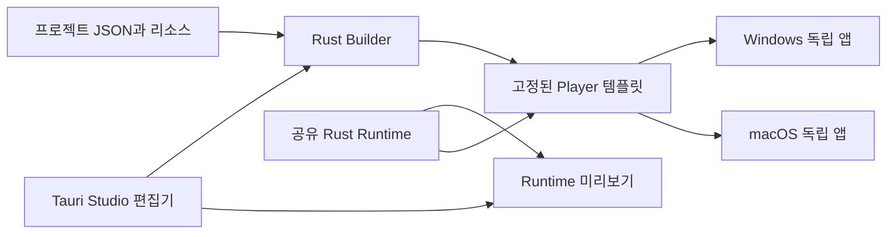

# 아키텍처 설계

상태: Tauri + Rust 기반 상세 설계 제안 / 기준일: 2026-11-07

## 1. 시스템 경계



Builder는 컴파일·패키징 도구이고 Runtime은 생성 앱의 실행 엔진이다. Studio를 닫거나 제거해도 이미 생성된 앱은 동작한다. 하나의 OS에서 다른 OS용 설치 파일까지 자동 생성하는 것은 초기 계약에 포함하지 않는다.

## 2. 제안 저장소 구조

다음은 구현할 구조이며 현재 파일이 존재한다는 뜻은 아니다.

```text
apps/
  studio/                    # 프로젝트 관리·편집·미리보기 GUI
    src/                     # 제안: TypeScript
    src-tauri/               # Studio의 Rust 호스트
  player/                    # 생성 앱의 Tauri 템플릿
    src/                     # 캐릭터 Canvas, 사용자 설정 화면
    src-tauri/               # 얇은 호스트, Runtime 조립
crates/
  buddy-project/             # 프로젝트/팩 스키마, 검증, 마이그레이션
  buddy-runtime/             # 행동·입력 상태·사용자 기본값 결합
  buddy-platform/            # Windows/macOS 입력·좌표·권한 어댑터
  buddy-builder/             # 생성·빌드 작업·산출물 보고
tools/
  buddy/                     # Builder CLI
packages/
  renderer/                  # Player와 Studio 미리보기의 공통 화면 코드
examples/
  typing-cat/                # JSON과 리소스만 다른 샘플
  click-mascot/
docs/
```

Rust workspace와 웹 패키지 workspace를 사용한다. 사용하지 않는 런타임 플러그인을 생성 앱에 포함하지 않는다. Studio용 파일 편집·빌드 실행 권한은 Player에 포함하지 않는다.

## 3. 책임과 상태 소유권

| 구성 | 책임 | 소유하는 상태 |
| --- | --- | --- |
| Project Core | 스키마·참조·자산 한도 검증 | 검증된 불변 프로젝트 |
| Builder | 템플릿 생성, 도구체인 호출, 패키징 | 작업 ID, 단계, 캐시 키, 취소 토큰 |
| Platform Adapter | 입력 관찰, 권한, 모니터/좌표 | 네이티브 핸들·스레드·권한 상태 |
| Runtime Core | 입력 정규화, 동작 선택, 위치 적분 | 눌린 키, 동작, 위치, 사용자 설정 |
| Host Window Manager | 창 생성, 표시 모드, 트레이 | 창 핸들, 모니터 배치, 설정 창 |
| Renderer | 프레임 선택, 이미지 그리기 | 로드된 이미지, 렌더 시계, 마지막 snapshot |
| Studio | 프로젝트 편집과 검증 결과 표시 | 편집 중 문서, 저장 여부 |

프로젝트 기본값은 배포 리소스로 읽고, 사용자가 바꾼 위치·배율 등은 앱 데이터 디렉토리에 따로 저장한다. Rust 상태가 런타임의 기준이며 Canvas가 네이티브 입력 상태를 소유하지 않는다.

## 4. 입력 파이프라인

```text
OS 콜백
  → 짧은 수신 처리 / 제한된 큐
  → Rust InputNormalizer
  → ActionMapper + HeldState
  → Runtime 상태 / 위치 계산
  → 의미 기반 snapshot + 일회성 효과
  → Renderer
```

### Windows

Raw Input 수신용 숨겨진 윈도우와 메시지 루프를 별도 소유한다. 키보드·마우스 사용 페이지에 `RIDEV_INPUTSINK`를 등록하는 방식을 우선 검증한다. `RIDEV_EXINPUTSINK`는 전경 앱의 처리 여부에 따라 달라지므로 동일한 대체재로 쓰지 않는다. 입력 차단 플래그·키 재전송은 사용하지 않는다. Raw Input의 마우스 상대 이동을 커서 절대 좌표라고 취급하지 않고 OS 커서 위치를 별도로 얻어 변환한다. [Microsoft 근거](https://learn.microsoft.com/en-us/windows/win32/api/winuser/ns-winuser-rawinputdevice)

### macOS

일반 사용자 세션에서 listen-only event tap과 전용 run loop를 검증한다. root 전용 위치에 tap을 설치하는 방식은 사용하지 않는다. callback에서 파일·네트워크·무거운 렌더 처리를 하지 않는다. 생성 실패, 권한 거부, tap 비활성화를 구분해 복구한다. 입력 권한 점검·요청은 사용자가 누른 재시도 경로로 수행한다. [Apple tap](https://developer.apple.com/documentation/coregraphics/cgevent/tapcreate(tap:place:options:eventsofinterest:callback:userinfo:)), [listen-only](https://developer.apple.com/documentation/coregraphics/cgeventtapoptions/listenonly)

### 공통 규칙

- 키는 조합된 문자가 아닌 정규화한 물리 키 ID로 표현한다. 한/영 IME 텍스트 변환을 구현하지 않는다.
- `down/up`, 좌우 modifier, 버튼, 휠 방향과 크기를 구분한다. 매핑할 수 없는 키는 `Unknown`으로 처리하고 임의 문자로 추정하지 않는다.
- OS 반복 keydown은 `repeat`로 구분한다. 타이핑 애니메이션 쿨다운과 held 이동을 분리한다.
- 마우스 이동은 최신 위치로 병합해 최대 30회/초 전달한다. 키·클릭 전이를 임의로 드롭하지 않는다.
- 큐가 넘치면 오류를 기록하고 input epoch를 증가시켜 held 상태를 초기화한다. 조용히 keyup을 잃어 무한 이동하게 하지 않는다.
- 절전·잠금·권한 중단·입력 어댑터 재시작 시 epoch를 바꾸고 키·버튼·이동 상태를 초기화한다.
- 입력이 한동안 없다는 사실만으로 권한이 없어졌다고 판단하지 않는다.
- Runtime에서 렌더러로 일반 키 입력 전체를 방송하지 않는다. 화면에는 선택된 동작·방향·집계 상태만 보낸다.

## 5. 동작 엔진

동작은 `playAnimation`, `move`, `faceCursor`의 제한된 집합으로 시작한다. 사용자 정의 코드는 실행하지 않는다.

| 상황 | 규칙 |
| --- | --- |
| 기본 상태 | 유효한 상위 동작이 없으면 `idle` |
| 일회성 애니메이션 | 높은 priority 우선, 같은 priority는 정의 순서가 빠른 매핑 우선 |
| 재입력 | `restart`는 재시작, `ignore`는 재생 중 무시, 별도 쿨다운 적용 |
| 키 유지 이동 | down/up으로 held 집합 갱신, 속도 × 단조 시간 차이로 이동 |
| 반대 방향 동시 입력 | X/Y 축을 합산하고 -1~1로 제한, 대각선은 속도 정규화 |
| 큰 시간 차이 | tick delta 최대 50 ms, 절전 복귀 후 누적 이동 없음 |
| 권한 없음·일시 정지 | 입력 기반 동작과 held 상태 해제, 유휴 표시 유지 |
| 존재하지 않는 애니메이션 | 빌드 검증 실패. 실행 중 리소스 손상은 기본 idle 또는 내장 오류 이미지 |

이동은 창 좌표를 실제로 변경하는 동작이다. 캐릭터 안의 팔·몸 움직임을 그리는 애니메이션과 별개다. 초기에는 선택된 모니터 작업 영역 안으로 이동을 제한한다.

## 6. 창과 좌표

- 캐릭터 주변의 작은 투명 오버레이 1개를 사용한다. 전체 화면 크기의 투명 캔버스를 만들지 않는다.
- 일반 표시 모드는 포커스 불가·클릭 통과다. 전역 입력 반응은 Platform Adapter가 제공한다.
- 트레이에서 편집 모드를 켜면 테두리와 드래그 핸들을 표시하고 클릭 통과를 끈다. 완료하면 표시 모드로 복귀한다.
- 배율은 렌더러 transform으로 적용하고, 창 크기·여백은 Host가 필요한 범위로 조정한다. 필요하면 위치를 보존한 채 창 재생성으로 폴백한다.
- 창 생성 시부터 포커스를 제어한다. 이미 포커스된 macOS 창에 `setFocusable(false)`만 호출하면 충분하다고 가정하지 않는다. [Tauri 창 API](https://v2.tauri.app/reference/javascript/api/namespacewindow/)
- 위치 저장은 모니터 식별 힌트와 모니터 내부 로컬 DIP 좌표를 사용한다. 서로 다른 OS의 전역 원점이나 물리 픽셀을 그대로 저장·재사용하지 않는다.
- 커서 좌표는 어댑터에서 OS 원점·모니터 원점·배율을 적용해 현재 창 로컬 좌표로 변환한다. 모든 모니터 좌표를 하나의 scaleFactor로 나누지 않는다.
- 모니터 제거·배율 변경 시 작업 영역을 다시 읽고 표시 가능한 위치로 제한한다. 초기 팩 크기는 모니터에 맞게 자동 축소한다.

항상 위는 일반 데스크톱 창에 대한 정책이다. 독점 전체 화면 게임·보안 데스크톱·잠금 화면 위 표시를 보장하지 않는다.

## 7. IPC 계약

명령과 타입 이름은 제안이며 실제 공개 API가 아니다. Rust `serde` 타입에서 TypeScript DTO를 생성하거나 CI에서 일치 여부를 검사한다.

| 명령/스트림 | 호출자 | 역할 |
| --- | --- | --- |
| `get_runtime_status` | Player 설정/overlay | 표시·권한·프로젝트 상태 읽기 |
| `subscribe_character_state` | overlay | 초기 전체 snapshot 이후 순서 있는 상태 수신 |
| `apply_user_preferences` | Player 설정 | 검증된 위치·배율·감지 토글 적용 |
| `request_input_access` | Player 설정 | 사용자 동작으로 입력 권한 요청/재점검 |
| `validate_project` | Studio | 데이터 검증 결과 |
| `start_build` / `cancel_build` | Studio | 제한된 Builder 작업 실행 |
| `subscribe_build_progress` | Studio | 작업별 진행·결과 수신 |

상태 스트림은 Tauri Channel로 제한된 속도의 데이터만 전송한다. 프레임 이미지를 IPC로 보내지 않는다. 각 메시지에는 `protocolVersion`, `epoch`, `seq`가 있고 동작 시작에는 `actionInstanceId`를 둔다. 일회성 동작이 연속 입력에서 합쳐지지 않도록 시작 식별자를 바꾸고, 재연결 시 전체 상태로 복구한다. [Tauri Channel 근거](https://v2.tauri.app/develop/calling-frontend/#channels)

창 label별로 허용 명령을 제한하고 Rust 명령 진입부에서도 호출 창·프로젝트 루트를 검사한다. Custom command와 event가 capability만으로 자동으로 세밀하게 보호된다고 가정하지 않는다. Player에는 프로젝트 편집·셸·빌드 명령을 등록하지 않는다. [Tauri capabilities](https://v2.tauri.app/security/capabilities/)

## 8. 자산·데이터와 수명

프로젝트 리소스는 [프로젝트 형식](project-format.md)의 규칙으로 검증한다. 렌더러는 검증된 로컬 자산만 읽고 원격 HTML·스크립트를 로드하지 않는다. 사용자 경로·앱 이름을 셸 문자열이나 실행 코드로 삽입하지 않는다.

앱별 설정은 `appIdentifier`에 종속된 데이터 디렉토리에 원자적 교체로 저장한다. 스키마 버전이 높으면 조용히 덮어쓰지 않고 읽기 오류를 표시한다. 설정 창을 닫으면 해당 WebView를 해제하고, 숨긴 overlay는 렌더·입력 처리도 일시 정지한다.

종료 시 입력 어댑터·run loop·메시지 윈도우·채널을 정리한다. Studio 미리보기는 최대 1개로 두며, 중단 시 동일한 정리 경로를 사용한다. 앱별 단일 인스턴스는 같은 앱만 중복 방지하고 다른 생성 앱을 막지 않아야 한다.
