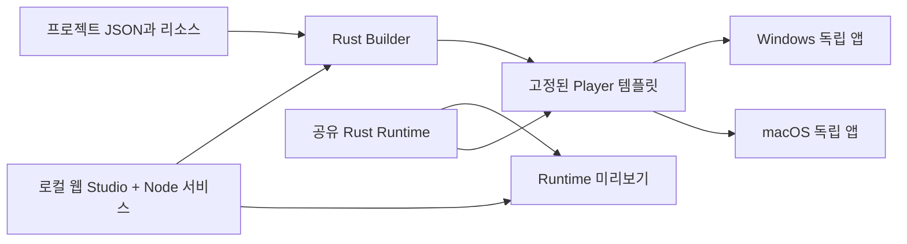

# 아키텍처 설계

상태: v1 구현 기준, 구현·실기 검증 전 / 기준일: 2026-11-07

## 1. 시스템 경계



Builder는 컴파일·패키징 도구이고 Runtime은 생성 앱의 실행 엔진이다. Studio를 닫거나 제거해도 이미 생성된 앱은 동작한다. 하나의 OS에서 다른 OS용 설치 파일까지 자동 생성하는 것은 초기 계약에 포함하지 않는다.

## 2. 구현할 저장소 구조

현재 구현 구조다. 추가 리소스·로컬 웹 Studio·직접 드래그 계약은 [ADR 0004](decisions/0004-project-studio-and-media.md)를 따른다.

```text
apps/
  studio/                    # 프로젝트 관리·편집·미리보기 GUI
    src/                     # TypeScript + Vite, 최초에는 별도 UI 프레임워크 없음
  player/                    # 생성 앱의 Tauri 템플릿
    src/                     # 캐릭터 Canvas, 사용자 설정 화면
    src-tauri/               # 얇은 호스트, Runtime 조립
crates/
  buddy-project/             # 프로젝트/팩 스키마, 검증, 마이그레이션
  buddy-runtime/             # 행동·입력 상태·사용자 기본값 결합
  buddy-platform/            # Windows/macOS 입력·좌표·권한 어댑터
  buddy-builder/             # 생성·빌드 작업·산출물 보고
tools/
  buddy/                     # Builder CLI
packages/
  renderer/                  # Player와 Studio 미리보기의 공통 화면 코드
studio/                      # Node 로컬 서비스·저장소·빌드 대기열
packaging/                   # 고지·라이선스·패키지 규칙
examples/
  typing-cat/                # JSON과 리소스만 다른 샘플
  click-mascot/
docs/
```

Rust workspace와 웹 패키지 workspace를 사용한다. 사용하지 않는 런타임 플러그인을 생성 앱에 포함하지 않는다. Studio용 파일 편집·빌드 실행 권한은 Player에 포함하지 않는다.

## 3. 책임과 상태 소유권

| 구성 | 책임 | 소유하는 상태 |
| --- | --- | --- |
| Project Core | 스키마·참조·자산 한도 검증 | 검증된 불변 프로젝트 |
| Builder | 템플릿 생성, 도구체인 호출, 패키징 | 작업 ID, 단계, 캐시 키, 취소 토큰 |
| Platform Adapter | 입력 관찰, 권한, 모니터/좌표 | 네이티브 핸들·스레드·권한 상태 |
| Runtime Core | 입력 정규화, 속도·키 순서, 동작 선택, 위치 적분 | held, 동작, 세션 위치, 검증된 사용자 설정, 휘발성 matcher |
| Host Window Manager | 창 생성, 표시 모드, 트레이 | 창 핸들, 모니터 배치, 설정 창 |
| Renderer | Rust의 동작 시각으로 프레임 선택·그리기 | 로드된 이미지, 수신 후 보간 시계, 마지막 snapshot |
| Studio | 프로젝트 편집과 검증 결과 표시 | 편집 중 문서, 저장 여부 |

프로젝트 기본값은 배포 리소스로 읽고, 사용자가 바꾼 위치·배율 등은 앱 데이터 디렉토리에 따로 저장한다. Rust 상태가 런타임의 기준이며 Canvas가 네이티브 입력 상태를 소유하지 않는다.

Runtime Core는 Tauri·OS API·파일 I/O·실제 시계에 직접 의존하지 않는다. Host가 `step(now, events, environment)` 형태로 단조 시각·정규 이벤트·유효 입력 상태·작업 영역을 주입하고, 코어는 snapshot·창 변경 의도·다음 처리 시각을 반환한다. 실제 타이머·창 이동·저장은 Host가 수행한다. Rust 타입에서 JSON Schema·TypeScript DTO를 생성하고 CI에서 차이를 검사한다.

## 4. 입력 파이프라인

```text
OS 콜백
  → 짧은 수신 처리 / 제한된 큐
  → Rust InputNormalizer
  → ActionMapper + HeldState + TypingRate + SequenceMatcher
  → Runtime 상태 / 위치 계산
  → 의미 기반 snapshot / actionInstanceId
  → Renderer
```

### Windows

Raw Input 수신용 숨겨진 윈도우와 메시지 루프를 별도 소유한다. 키보드·마우스 사용 페이지에 `RIDEV_INPUTSINK`를 등록하는 방식을 우선 검증한다. `RIDEV_EXINPUTSINK`는 전경 앱의 처리 여부에 따라 달라지므로 동일한 대체재로 쓰지 않는다. 입력 차단 플래그·키 재전송은 사용하지 않는다. Raw Input의 마우스 상대 이동을 커서 절대 좌표라고 취급하지 않고 OS 커서 위치를 별도로 얻어 변환한다. [Microsoft 근거](https://learn.microsoft.com/en-us/windows/win32/api/winuser/ns-winuser-rawinputdevice)

`RIDEV_DEVNOTIFY`로 장치 변경을 받고, 장치별 held 집합을 세션 합집합으로 합친다. 같은 키를 두 장치에서 누른 경우 하나의 release가 다른 장치의 held를 해제하지 않는다. 장치 제거 시 해당 장치 상태를 제거하고 필요하면 epoch reset한다. [장치 변경 알림](https://learn.microsoft.com/en-us/windows/win32/inputdev/wm-input-device-change)

### macOS

일반 사용자 세션에서 listen-only event tap과 전용 run loop를 검증한다. root 전용 위치에 tap을 설치하는 방식은 사용하지 않는다. callback에서 파일·네트워크·무거운 렌더 처리를 하지 않는다. 생성 실패, 권한 거부, tap 비활성화를 구분해 복구한다. 입력 권한 점검·요청은 사용자가 누른 재시도 경로로 수행한다. [Apple tap](https://developer.apple.com/documentation/coregraphics/cgevent/tapcreate(tap:place:options:eventsofinterest:callback:userinfo:)), [listen-only](https://developer.apple.com/documentation/coregraphics/cgeventtapoptions/listenonly)

tap에서 장치별 ID를 얻는다고 가정하지 않고 세션 통합 키 상태를 사용한다. held가 있는 동안 250 ms마다 OS 키 상태와 대조해 누락된 release를 해제하며 새 down을 합성하지 않는다. 보안 입력·세션 비활성화·조회 실패는 키보드 수신 중단으로 처리하고 epoch를 바꾼다. modifier는 flagsChanged와 좌우 키 상태를 정규 이벤트로 변환한다. 보안 입력이 이벤트 전달을 제한할 수 있다는 근거는 [Apple TN2150](https://developer.apple.com/library/archive/technotes/tn2150/_index.html)이며 보관 문서이므로 실제 지원 OS에서 별도 검증한다.

키 상태 대조는 Windows에도 적용한다. 사용 중인 OS 키 상태 API의 한계와 관찰 가능한 키를 M0 지원표로 기록하고, 상태를 확인할 수 없으면 held를 안전하게 해제한다. 관찰되지 않은 키를 눌림으로 복원하지 않는다.

### 전역 속도와 키워드

특정 키·속도·한글 키워드 모두 동일한 전역 물리 키 파이프라인으로 처리한다. 캐릭터 앱이나 Studio에 포커스를 요구하지 않는다. 한글 keyword는 Project Core가 두벌식 steps로 변환하고 SequenceMatcher가 Shift 상태를 포함한 입력 순서를 검사한다. 현재 IME 모드·다른 앱의 텍스트를 읽거나 대상 앱에 입력하지 않는다. 정규화 이벤트는 일회성 후보 선택 전에 속도 집계와 matcher에 전달한다. [전역 입력 속도와 키워드](input-and-keywords.md)가 변환·계산·중단 규칙의 기준이다.

### 공통 규칙

- 키는 조합된 문자가 아닌 정규화한 물리 키 ID로 표현한다. 한/영 IME 텍스트 변환을 구현하지 않는다.
- `down/up`, 좌우 modifier, 버튼, 휠 방향과 크기를 구분한다. 매핑할 수 없는 키는 `Unknown`으로 처리하고 임의 문자로 추정하지 않는다.
- OS 반복 keydown은 `repeat`로 구분한다. 타이핑 애니메이션 쿨다운과 held 이동을 분리한다.
- 마우스 이동은 최신 위치로 병합해 최대 30회/초 전달한다. 키·클릭 전이를 임의로 드롭하지 않는다.
- 큐가 넘치면 오류를 기록하고 input epoch를 증가시켜 held 상태를 초기화한다. 조용히 keyup을 잃어 무한 이동하게 하지 않는다.
- 절전·잠금·권한 중단·입력 어댑터 재시작 시 epoch를 바꾸고 키·버튼·이동 상태를 초기화한다.
- epoch 변경 시 오래된 큐·일회성 반응·쿨다운·속도 집계·키워드 접두 상태도 폐기한다. 재개 시 현재 눌린 키는 release를 확인할 때까지 억제하고 새 non-repeat down부터 반응한다. 반복 down으로 held를 재생성하지 않는다.
- 입력이 한동안 없다는 사실만으로 권한이 없어졌다고 판단하지 않는다.
- Runtime에서 렌더러로 일반 키 입력 전체를 방송하지 않는다. 화면에는 선택된 동작·방향·집계 상태만 보낸다.

## 5. 동작 엔진

동작은 `playAnimation`, `sustainAnimation`, `move`, `faceCursor`의 제한된 집합이다. 사용자 정의 코드는 실행하지 않는다. 구체적인 필드·우선순위·반복 규칙의 기준 문서는 [프로젝트 형식](project-format.md)이다.

| 상황 | 규칙 |
| --- | --- |
| 기본 상태 | 키 유지 sustain → 활성 속도 구간 → 실제 이동의 move.animation → idle |
| 일회성 애니메이션 | 기본 상태 위에 표시, loop=false 필수. 높은 priority·빠른 정의 순서 우선 |
| 재입력·중단 | 같은 binding의 restart만 재시작, ignore는 폐기. 중단 반응은 재개하지 않고 실제 시작만 쿨다운 소비 |
| 종료 | Rust가 정규화된 프레임 시간 합계 또는 durationMs로 판정. 현재 기본 상태를 처음부터 표시, 렌더러 ACK 불필요 |
| 키 유지 이동 | down/up으로 held 집합 갱신, 속도 × 단조 시간 차이로 이동 |
| 반대 방향 동시 입력 | X/Y 축 합산·-1~1 제한·길이 1 초과 정규화 후 활성 최대 속도 적용 |
| 큰 시간 차이 | tick delta 최대 50 ms, 절전 복귀 후 누적 이동 없음 |
| 권한 없음·일시 정지 | 입력 기반 동작과 held 상태 해제, 유휴 표시 유지 |
| 존재하지 않는 애니메이션 | 빌드 검증 실패. 실행 중 리소스 손상은 기본 idle 또는 내장 오류 이미지 |

이동은 창 좌표를 실제로 변경하는 동작이다. 캐릭터 안의 팔·몸 움직임을 그리는 애니메이션과 별개다. 초기에는 선택된 모니터 작업 영역 안으로 이동을 제한한다.

이동 중에만 최대 60 Hz로 위치를 계산하고 tick delta는 최대 50 ms다. 속도 구간 평가는 활성 입력 중 설정한 평가 간격(기본 50 ms)마다 수행하며, 일회성 종료에는 deadline 타이머를 사용한다. 아무 동작·집계가 없는 상태에 고정 주기 Rust tick을 유지하지 않는다. 렌더러는 최대 30 FPS로 필요한 프레임만 그리고 정적 프레임·숨김에서는 재그리기를 중지한다. 기본 반복 애니메이션은 Rust가 제공한 경과 시각을 보간하되 동작 종료·교체를 결정하지 않는다.

### Runtime 모드와 입력 상태

사용자 의도 `input.keyboard/mouse`와 세션 상태를 분리한다. keyboard/mouse 권한은 `notRequired`/`needsRequest`/`granted`/`denied`, 실제 수신은 `stopped`/`running`/`suspended`/`failed`다. `get_runtime_status`는 소스별 상태와 사유, 입력 원문 없는 reset 횟수·반응 성능 집계를 반환한다. 설정 조회는 mutex별 snapshot을 따로 얻어 구조체 필드 임시 guard가 역순으로 겹치지 않게 한다. keyboard 토글은 특정 키·속도·sequence를 함께 제어한다.

| 세션 상태 | 입력 처리 | 표시·복귀 규칙 |
| --- | --- | --- |
| 일반 표시 | 사용자 토글과 소스별 유효 상태에 따라 처리 | 키보드 포커스 불가·직접 드래그 |
| 드래그 | 전역 입력 동작 중지, epoch reset | 지정한 drag sustain 표시. 놓으면 새 기본 위치 저장, 설정을 열거나 숨기면 취소 |
| Player 설정 창 열림 | 전역 입력 동작 중지, epoch reset | 설정 창만 포커스 허용. 대기 모습과 직접 드래그를 지원하며 닫으면 현재 모드를 재평가 |
| 숨김 | 어댑터 수신·렌더 중지 | 사용자 토글 유지. 표시 시 새 세션·입력부터 시작 |
| 트레이 전체 입력 일시 정지 | 모든 입력 소스 중지, epoch reset | idle 표시. 세션용 토글이며 재시작 시 해제 |
| 한 소스의 권한 거부·중단 | 해당 소스 해제·epoch reset, 유효한 다른 소스는 계속 | 상태·복구 안내. 아무 소스도 없으면 idle |

숨기거나 설정을 새로 열면 진행 중인 드래그를 취소한다. 이미 설정을 열어둔 상태에서 버디를 드래그하면 창을 유지한다. 설정 저장은 바꾼 항목만 적용하므로 방금 저장한 드래그 위치와 트레이 토글을 되돌리지 않는다. 모드 변경은 Host에서 직렬 처리한다. 설정·드래그 중 전역 입력은 동작·속도·키워드에 쓰지 않는다. 복귀해도 이전 입력을 재생하지 않는다. 트레이에는 실제 감지 상태와 체크형 표시·일시 정지·소스 토글, 설정, 위치 초기화, 설정 초기화, 종료를 제공한다. 사용자 입력 감지를 꺼도 버디 직접 드래그는 사용할 수 있다.

## 6. 창과 좌표

- 캐릭터 주변의 작은 투명 오버레이 1개를 사용한다. 전체 화면 크기의 투명 캔버스를 만들지 않는다.
- 일반 표시 모드는 키보드 포커스를 빼앗지 않고 버디 창 영역에서 직접 드래그를 받는다. 전역 입력 반응은 Platform Adapter가 제공한다.
- 드래그는 내부 세션 ID로 직렬 처리하고 놓을 때 위치를 저장한다. 크기는 설정에서 조절한다. 현재 선택한 모니터 작업 영역 안으로 이동을 제한한다.
- 배율은 렌더러 transform으로 적용하고, 창 크기·여백은 Host가 필요한 범위로 조정한다. 좌우 반전은 character.anchor.x를 고정하며, Host는 양쪽 반전 범위를 담는 여백을 확보해 자르거나 기준점이 이동하지 않게 한다. 필요하면 위치를 보존한 채 창 재생성으로 폴백한다.
- 창 생성 시부터 포커스를 제어한다. 이미 포커스된 macOS 창에 `setFocusable(false)`만 호출하면 충분하다고 가정하지 않는다. [Tauri 창 API](https://v2.tauri.app/reference/javascript/api/namespacewindow/)
- 위치 저장은 모니터 식별 힌트와 선택한 모니터 작업 영역의 왼쪽 위 (0, 0)를 기준으로 한 로컬 DIP 좌표를 사용한다. 서로 다른 OS의 전역 원점이나 물리 픽셀을 그대로 저장·재사용하지 않는다.
- 저장되는 basePlacement와 자동 이동한 sessionPosition은 분리한다. 재시작은 basePlacement에서 시작하며 자동 이동 tick마다 디스크에 쓰지 않는다. 편집은 현재 sessionPosition에서 시작한다.
- 커서 좌표는 어댑터에서 OS 원점·모니터 원점·배율을 적용해 현재 창 로컬 좌표로 변환한다. 모든 모니터 좌표를 하나의 scaleFactor로 나누지 않는다.
- 모니터 제거·배율 변경 시 작업 영역을 다시 읽고 표시 가능한 위치로 제한한다. Renderer도 devicePixelRatio의 media query와 창 크기 변경을 관찰해 DIP 크기가 같아도 backing canvas 해상도를 갱신한다. 현재 Host는 2초 주기의 저빈도 모니터 상태 점검을 사용한다. 모니터 힌트는 OS 이름과 중복 순서에서 파생하며 하드웨어 고유 ID를 보장하지 않는다. 힌트가 사라지면 주 모니터의 기본 anchor로 복구한다. 초기 팩 크기는 모니터에 맞게 자동 축소한다.

항상 위는 일반 데스크톱 창에 대한 정책이다. 독점 전체 화면 게임·보안 데스크톱·잠금 화면 위 표시를 보장하지 않는다.

Player overlay는 Windows 작업 표시줄·Alt-Tab 및 macOS Dock에 일반 앱 창으로 노출하지 않는 트레이 중심 앱으로 구성한다. macOS에서는 생성된 일반 데스크톱 Space에 속하게 하고 모든 Spaces를 따라다니는 기능은 v1에 넣지 않는다. 표시·설정 열기가 Space를 자동 전환하지 않도록 M0에서 검사한다. 일반 전체 화면 앱을 포함해 다른 Space 위 표시를 보장하지 않는다. 위치 초기화는 현재 선택 모니터의 프로젝트 기본 anchor로 복구하며, 설정 초기화와 달리 입력 동의를 바꾸지 않는다.

## 7. IPC 계약

아래는 내부 IPC 계약이다. Player 명령은 구현·검증 중이며, Studio는 Tauri IPC 대신 인증된 로컬 HTTP API로 프로젝트 관리와 CLI 검증·빌드를 제공한다. 상세 경계는 [Studio 안내](studio.md)를 따른다. 실제 타입은 생성된 contracts와 해당 Rust 진입부를 따른다. Rust `serde` 타입에서 TypeScript DTO를 생성하고 CI에서 재생성 차이를 검사한다.

| 명령/스트림 | 호출자 | 역할 |
| --- | --- | --- |
| `get_runtime_status` | Player 설정 | 표시·권한·프로젝트 상태 읽기 |
| `get_bootstrap` / `ack_character_frame` | overlay | 검증된 이미지 초기화 / 발행된 seq·epoch·actionInstanceId에 대한 drawn/error 통지 |
| `subscribe_character_state` | overlay | 초기 전체 snapshot 이후 순서 있는 상태 수신 |
| `reset_performance_session` / `export_runtime_diagnostics` | settings | 집계 초기화 / 앱 데이터 폴더의 고정 형식 JSON 저장. 임의 경로 인자 없음 |
| `apply_user_preferences` | Player 설정 | 변경한 위치·배율·타이밍·감지 토글만 검증해 적용 |
| `request_input_access` | Player 설정 | 사용자 동작으로 입력 권한 요청/재점검 |
| `reset_user_preferences` | Player 설정 | 위치만 초기화 또는 전체 설정 초기화 |
| `begin_character_drag` | overlay | 이동 임계값을 넘은 포인터에 편집 세션 부여 |
| `update_character_edit` / `finish_character_edit` / `cancel_character_edit` | overlay, 편집 세션 한정 | Host가 검증한 드래그·배율·편집 확정/취소 |
| `POST /api/projects/:id/validate` | Studio HTTP | 데이터 검증 결과 |
| `POST /api/projects/:id/builds` / `.../:job/cancel` | Studio HTTP | 제한된 Builder 작업 실행 |
| `GET /api/projects/:id/builds` | Studio HTTP | 작업별 진행·결과 조회 |

상태 스트림은 Tauri Channel로 최대 30회/초 snapshot을 전송한다. 프레임 이미지·키 목록·확정 텍스트를 보내지 않는다. visible 플래그로 숨김 렌더 중단을 명시하며 document visibility와 함께 적용한다. 각 메시지에는 protocolVersion·epoch·seq와 actionInstanceId·animationElapsedMs·기본 상태 종류가 있다. seq는 실제 발행 메시지마다 증가하며 입력 seq와 별개다. 재시작은 같은 애니메이션이어도 새 instance ID다. 편집 상태에는 Host가 발급한 editSessionId가 포함되며 편집 명령마다 이를 검사한다. Rust 입력 전이는 순서를 보존하지만 프레임 사이에 이미 중단된 시각 상태는 합칠 수 있으며 나중에 재생하지 않는다. seq 누락·재연결은 현재 전체 snapshot으로 복구한다. [Tauri Channel 근거](https://v2.tauri.app/develop/calling-frontend/#channels)

창 label별로 허용 명령을 제한하고 Rust 명령 진입부에서도 호출 창·프로젝트 루트를 검사한다. Custom command와 event가 capability만으로 자동으로 세밀하게 보호된다고 가정하지 않는다. Player에는 프로젝트 편집·셸·빌드 명령을 등록하지 않는다. [Tauri capabilities](https://v2.tauri.app/security/capabilities/)

overlay는 상태 읽기·구독·프레임 ACK와 직접 드래그 시작·이동·놓기 명령을 수행한다. 편집 명령은 등록하되 Rust에서 유효한 편집 세션 ID·현재 모드·배율/좌표 범위를 검사해 유효한 드래그 세션 중에만 허용한다. Player 설정에는 설정·모드·권한 관리와 제한된 진단만, Studio editor에는 프로젝트·Builder 명령만 허용한다. Studio preview는 mock 입력 주입과 Runtime 상태만 허용하고 실제 Player overlay에는 mock 주입을 등록하지 않는다. 직접 window/shell/fs 명령을 overlay에 열지 않는다. 빌드 시 capability 식별자를 명시하고 생성된 command manifest와 Rust 호출자 검사를 함께 검증한다.

프레임 ACK는 입력 반응 계측과 첫 표시 준비에 사용하며 동작 종료 판정을 바꾸지 않는다. Rust는 native callback 진입의 단조 시각을 제한된 입력 큐로 전달받아 큐 대기 시간까지 포함한다. 실제 시작한 일회성 반응은 epoch·actionInstanceId·수신 시각·FPS로만 추적한다. snapshot을 보내기 전에 상관 정보를 등록하고, Rust 잠금을 해제한 뒤 IPC를 보낸다. 렌더러는 같은 그림이라도 새 동작 instance를 실제 그린 다음 최초 drawn ACK를 보내며 error를 성공으로 보고하지 않는다. 발행 이력이 없는 ACK·중복·다른 epoch는 표본으로 인정하지 않는다. 초기 숨김 창의 첫 프레임은 document.hidden과 무관하게 준비하되 명시적 숨김 상태는 존중한다.

성능 메모리는 반응 512개, 발행 프레임 256개와 완료 ID 256개, FPS별 0~2000 ms의 1 ms 히스토그램으로 제한한다. 넘친 지연은 별도 개수와 최댓값을 남기며 p95를 2000 ms로 잘라 통과시키지 않는다. 반응 종료 후 5초에도 ACK가 없으면 미수신으로 집계한다. 입력 후보 거절·중단·snapshot 전 종료·ACK 누락·오류·추적 초과를 함께 공개한다. 설정의 초기화는 입력이 중지된 상태에서 새 epoch를 만들고 최초 표시 시간은 보존한다. 저장 JSON에는 프로젝트 hash·OS 종류/아키텍처·빌드 모드·배율과 집계만 포함하며 개별 입력·반응별 시각·binding 이름은 넣지 않는다. [시험 절차](testing-strategy.md)의 환경 기록과 실기 검증을 별도로 수행한다.

## 8. 자산·데이터와 수명

프로젝트 리소스는 [프로젝트 형식](project-format.md)의 규칙으로 검증한다. 렌더러는 검증된 로컬 자산만 읽고 원격 HTML·스크립트를 로드하지 않는다. 사용자 경로·앱 이름을 셸 문자열이나 실행 코드로 삽입하지 않는다.

Player와 Studio는 각 호스트에 맞는 CSP를 명시한다. Player는 Tauri IPC와 검증 후 생성한 PNG 캐시 파일만 자산 protocol로 허용하고 원격 탐색·새 창을 차단한다. Studio는 script/style/connect를 동일 origin으로 제한한 루프백 HTTP 서비스다. Host/Origin·세션 토큰·프로젝트별 canonical 경로를 검사하고 파일·셸 명령을 브라우저에 직접 노출하지 않는다. [Tauri CSP](https://v2.tauri.app/security/csp/)

현재 Player는 개발·배포 모두 번들 HTML을 사용한다. overlay/settings의 on_navigation은 플랫폼별 정확한 로컬 origin과 루트/index.html만 허용하고 query·다른 페이지·file/data/원격 URL은 거부한다. settings hash는 허용한다. on_new_window는 URL과 관계없이 Deny이며 CSP의 base-uri/form-action도 none이다. URL 정책의 자동 회귀와 실제 WebView 요청 차단 검증을 구분하며, 후자는 UI 실기 gate다.

앱별 preferences는 appIdentifier에 종속된 데이터 디렉토리에 저장한다. 개발용 디버그 Player와 CLI preview는 io.desktopbuddy.preview.<projectId> identity를 추가로 사용해 정식 앱 설정과 구분한다. 검증한 임시 파일을 같은 볼륨에 쓰고 flush 후 원자적으로 교체한다. 직전 정상 파일을 백업하며 저장 실패 시 디스크의 기존 값과 미저장 상태를 유지하고 오류를 알린다. 현재 세션 적용값을 저장 성공으로 표시하지 않는다. 자동 이동은 저장 대상이 아니다.

손상된 파일은 별도로 보존하고 동일/이전 지원 버전의 정상 백업을 복구한다. 백업도 없으면 기본값과 입력 off의 복구 세션으로 시작해 안내한다. 미래 schemaVersion 파일은 원본·백업을 덮어쓰지 않는 읽기 전용 복구 세션으로 시작한다. 명시적인 설정 초기화 전에는 저장하지 않는다. 마이그레이션은 백업→검증→원자적 교체를 따른다. 위치 초기화는 basePlacement만, 전체 설정 초기화는 배치·배율 등의 override 제거와 keyboard/mouse=false의 명시적 override 저장을 수행한다. 복구 세션의 입력 off도 사용자가 복구·저장을 승인하면 명시적으로 저장하며, 승인 전에는 원본 파일을 덮어쓰지 않는다.

설정과 백업은 읽기 단계부터 1 MiB+1까지만 가져온다. 원본이 1 MiB를 초과하면 미래 버전을 안전하게 판별할 수 없으므로 백업을 자동 적용하지 않고 원본·백업을 그대로 보존하는 읽기 전용/입력 off 세션으로 시작한다. 전체 초기화는 원본 사본을 보존한 뒤 명시적으로 수행한다. 백업 저장 실패 때도 현재 설정을 덮어쓰지 않고 임시 파일을 정리한다.

설정 창을 닫으면 해당 WebView를 해제하고, 숨긴 overlay는 렌더·입력 처리도 일시 정지한다. 키 이력·입력 원문은 저장·진단·일반 IPC에 포함하지 않는다. 2초 창의 키 값 없는 timestamp와 sequence 접두 길이만 최소 휘발성 상태로 유지하고 reset 시 폐기한다.

종료 시 입력 어댑터·run loop·메시지 윈도우·채널을 정리한다. Studio 미리보기는 최대 1개로 두며, 중단 시 동일한 정리 경로를 사용한다. 앱별 단일 인스턴스는 같은 앱만 중복 방지하고 다른 생성 앱을 막지 않아야 한다.

## GitHub Actions 빌드 어댑터

로컬 서비스의 ActionsBuilds가 인증·고정 팩 전송·workflow dispatch·진행 조회·취소·무결성 검사·프로젝트별 결과 보관을 담당한다. 브라우저는 인증된 로컬 API만 호출하며 GitHub 자격 증명을 보관하지 않는다. 로컬 빌드와 같은 jobs 이력에 provider=github와 플랫폼별 상태·고정 project/engine hash·원격 실행 ID를 추가한다. 재시작해도 원격 실행을 중단으로 바꾸지 않는다. 경계와 복구 계약은 [Actions 연동 안내](studio-actions.md)를 따른다.
